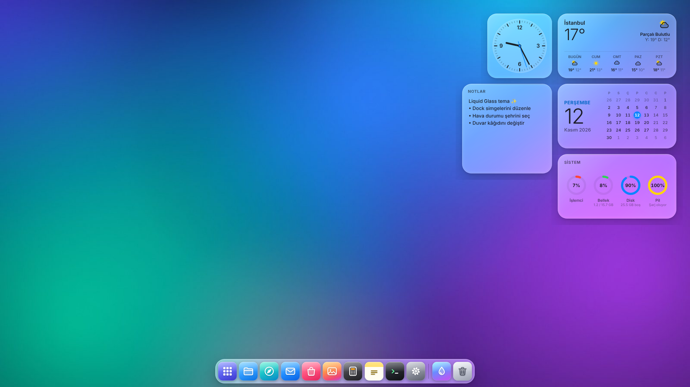
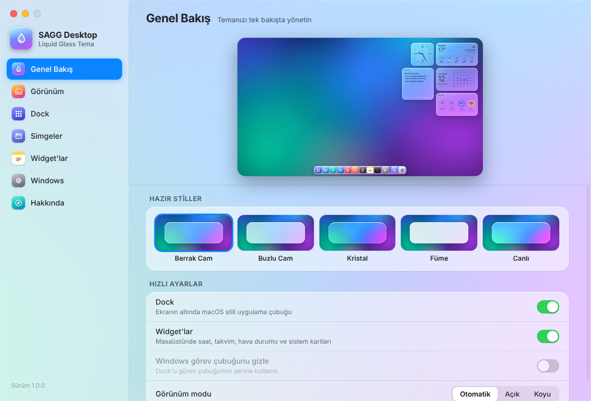
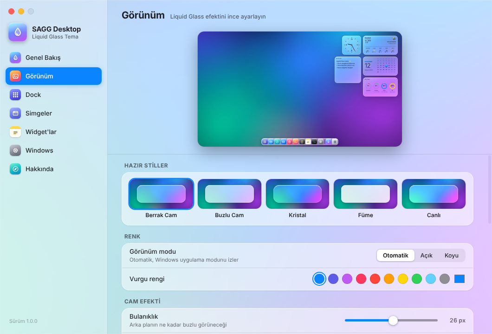
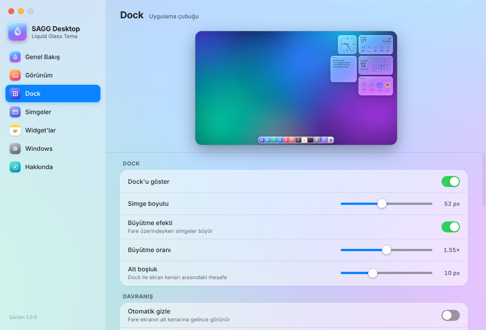
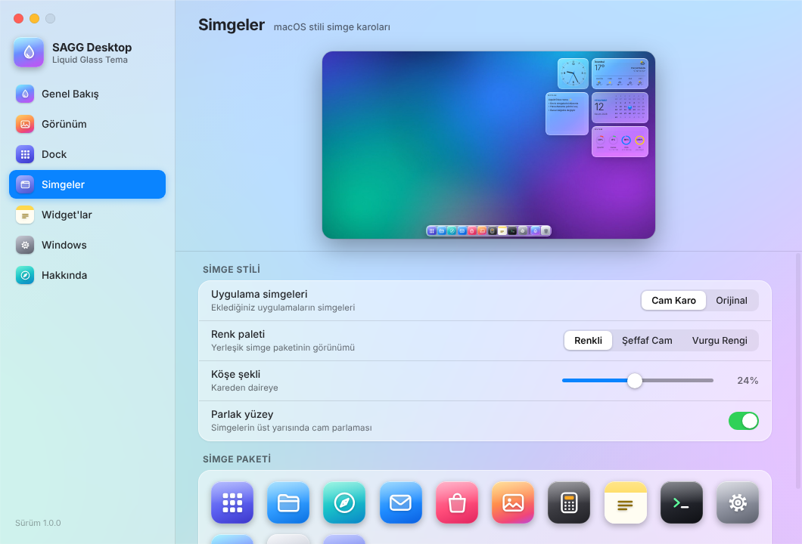
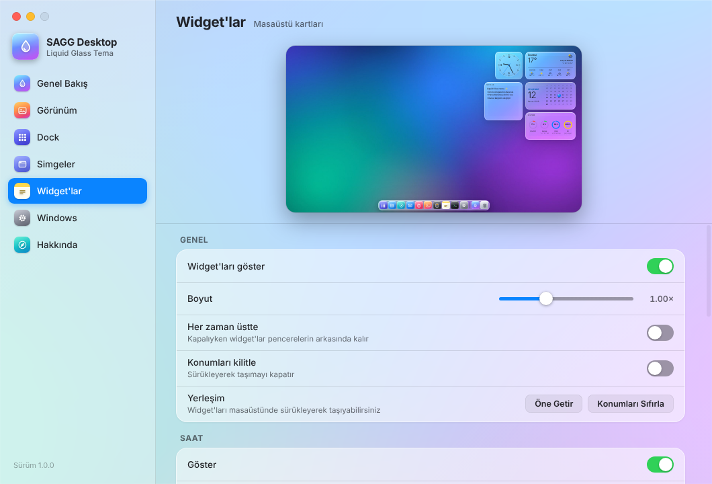
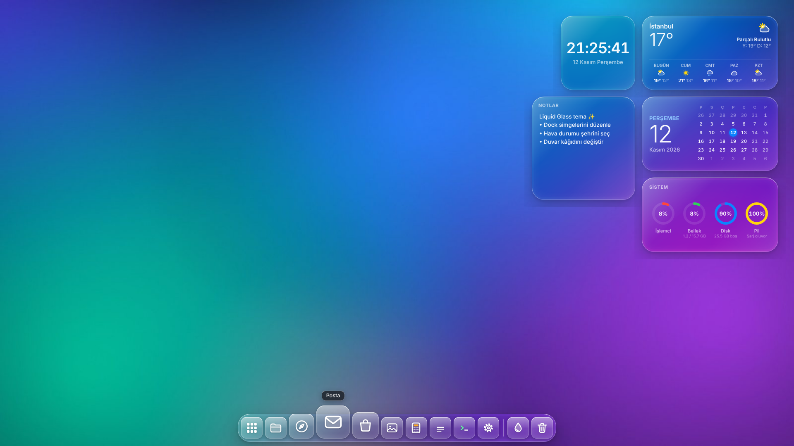

# SAGG Desktop Theme

Windows 11 için macOS stili, **Liquid Glass** efektli masaüstü teması: dock, masaüstü widget'ları, simge paketi ve hepsini yöneten bir ayarlar uygulaması.



## Özellikler

- **Dock** — büyütme efekti, uygulama etiketleri, çalışan uygulama göstergesi, otomatik gizleme, tam ekranda gizlenme. `.exe` ve kısayolları ekleyip sıralayabilir, simgelerini değiştirebilirsiniz.
- **Widget'lar** — Saat (analog/dijital), Takvim, Hava Durumu, Sistem (işlemci, bellek, disk, pil) ve Notlar. Sürükleyerek taşınır, konumları hatırlanır.
- **Simgeler** — yerleşik simge paketi (Renkli / Şeffaf Cam / Vurgu Rengi), uygulama simgeleri için cam karo, ayarlanabilir köşe şekli.
- **Liquid Glass** — bulanıklık, cam tonu, doygunluk, parlaklık, köşe yuvarlaklığı, kenar parlaması, kenar kırılması ve gölge ayarları; 5 hazır stil; açık/koyu/otomatik mod; vurgu rengi.
- **Windows entegrasyonu** — görev çubuğunu otomatik gizleme, görev çubuğu hizalaması, dock için alan ayırma (deneysel), Windows ile başlatma, ayarları dışa/içe aktarma.

Uygulama sistem dosyalarını değiştirmez. Yaptığı Windows ayarı değişiklikleri (görev çubuğu gizleme, çalışma alanı) uygulamadan çıkınca geri alınır.

## Kurulum

`SAGG-Desktop-Theme-Setup-<sürüm>.exe` dosyasını çalıştırın. Kurulum yönetici izni istemez (kullanıcı hesabına kurulur). Dosya dijital olarak imzalı olmadığı için Windows SmartScreen uyarı gösterebilir: **Ek bilgi → Yine de çalıştır**.

Ayarlar penceresini kapattığınızda tema sistem tepsisinde çalışmaya devam eder. `Ctrl + Alt + W` widget'ları öne getirir.

## Ekran görüntüleri

| | |
|---|---|
|  |  |
|  |  |
|  |  |

## Geliştirme

```bash
npm install
npm start          # uygulamayı çalıştırır
npm run dist       # dist/ altında Windows kurulum dosyasını (NSIS) üretir
```

- Windows dışında derlerken kurulum dosyasının son adımı için sistemde `wine` (32 bit destekli) bulunmalıdır. `.github/workflows/build.yml` aynı derlemeyi Windows üzerinde yapar, sessiz kurulum + öz-test + kaldırma çalıştırır ve kurulum dosyasını artifact olarak yükler.
- `"<uygulama>.exe" --selftest` Windows entegrasyonunu sınar ve sonucu `%APPDATA%\SAGG Desktop Theme\sagg.log` dosyasına yazar. Aynı dosya başlangıç sorunlarını teşhis etmek için de kullanılır.
- `scripts/gen-assets.js` + `scripts/make-ico.py` simgeleri ve duvar kâğıtlarını, `scripts/screenshots.js` ekran görüntülerini üretir (geliştirme zamanı araçları; Playwright ve Pillow ister).

### Yapı

| Yol | İçerik |
|---|---|
| `src/main/` | Ana süreç: pencereler, ayar deposu, sistem entegrasyonu |
| `src/native/helper.ps1` | Görev çubuğu, çalışma alanı, tam ekran algılama için PowerShell yardımcısı |
| `src/renderer/common/` | Liquid Glass motoru (`glass.css`, `theme.js`) ve simge paketi |
| `src/renderer/dock`, `widget`, `settings` | Arayüzler |

### Cam efekti nasıl çalışır

Windows, şeffaf bir pencerenin arkasındaki içeriği bulanıklaştırmaya izin vermez. Bu yüzden her cam panel, masaüstü duvar kâğıdının bulanık bir kopyasını kendi ekran konumuna hizalanmış şekilde arkasına çizer. Paneller duvar kâğıdını kırıyormuş gibi görünür; açık pencerelerin içeriği cama yansımaz.

## Lisans

MIT
